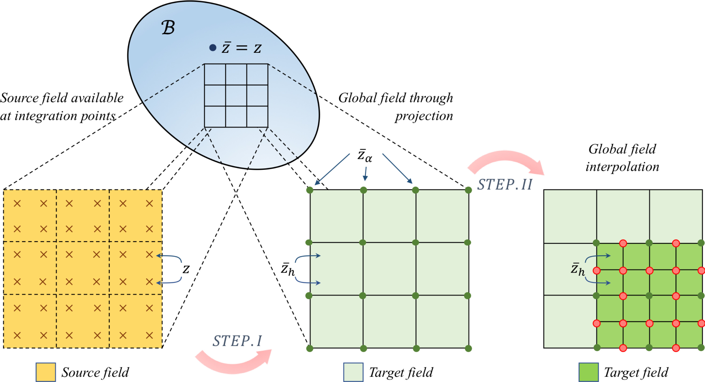
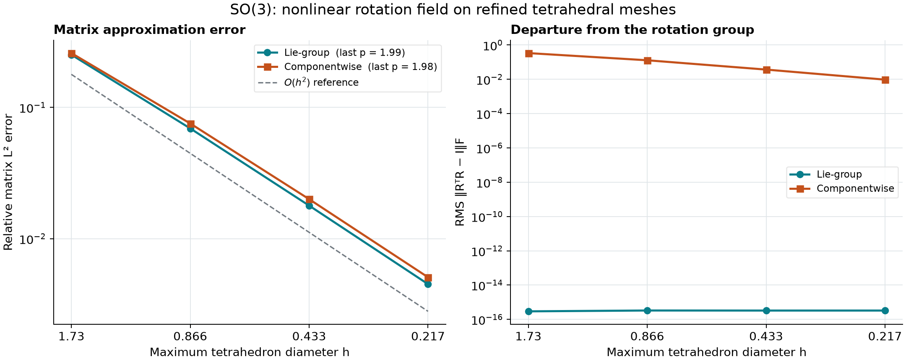
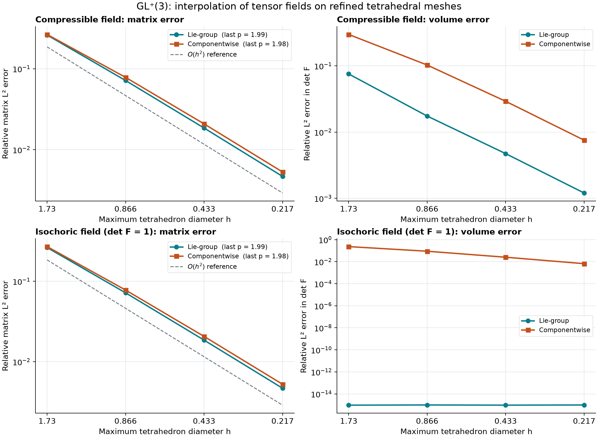
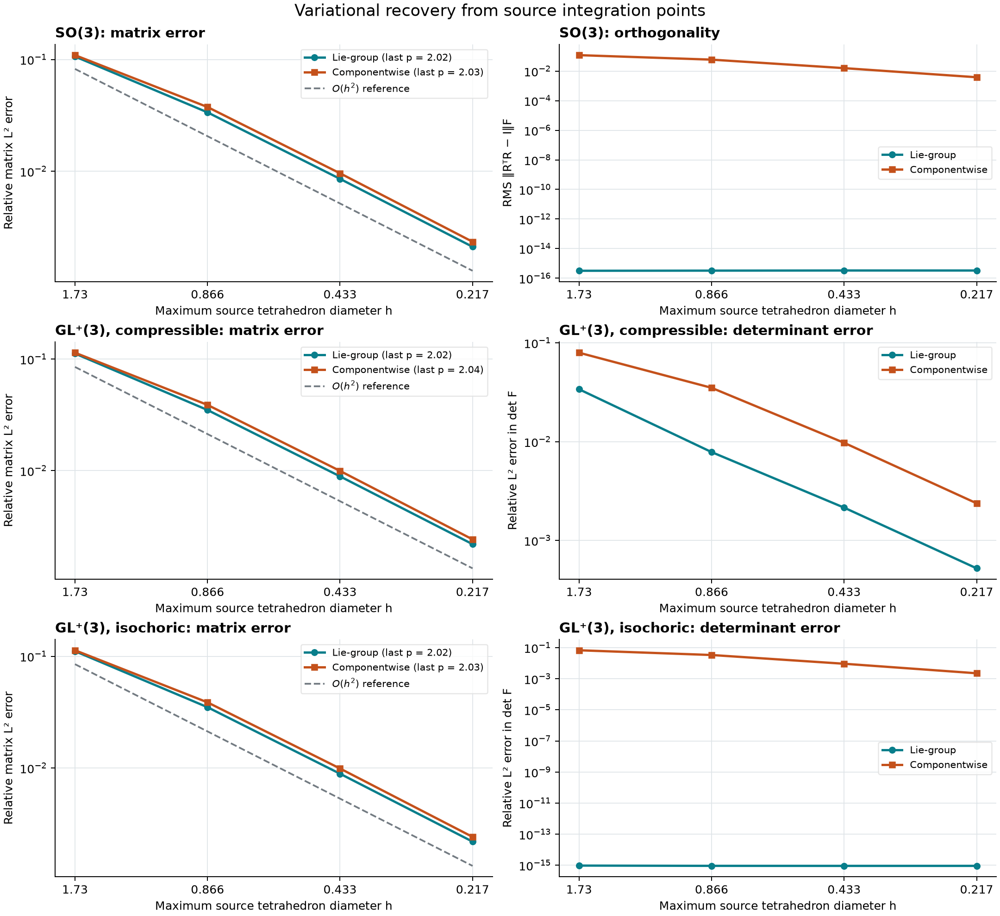
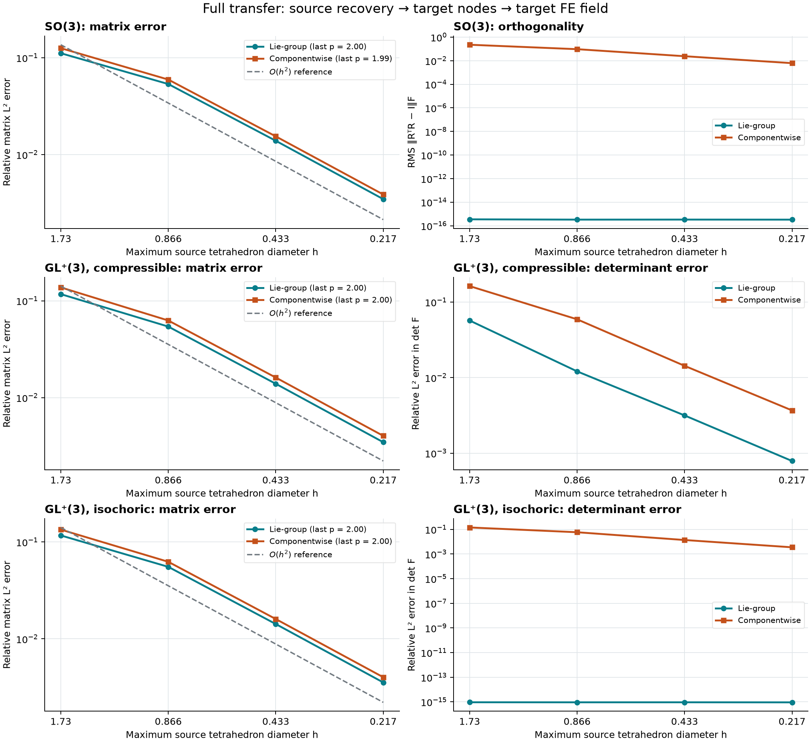

# Lie-group FEM

A small Python library for **Lie-group interpolation and variational reconstruction
of tensor fields in finite elements**. It provides local SO(3) rotation mapping,
polar GL⁺(3) mapping, and quadrature-to-node recovery in a declared common chart.

This is an independent implementation inspired by the references below. It has
no dependency on PhysicsWorlds, PBX_PM, a constitutive model, or a particular FEM
solver. The runtime dependencies are NumPy and SciPy; calculations use float64.

## Conceptual transfer workflow



*Conceptual two-stage transfer: recover integration-point data to a nodal field,
then interpolate that field onto a new mesh. Figure 1 from
[Na, Bryant & Sun (2019)](https://doi.org/10.1016/j.cma.2019.112572), modified in
that paper from [Mota et al. (2013)](https://doi.org/10.1007/s00466-013-0876-1).
Supplied by WaiChing Sun; see [third-party attribution](THIRD_PARTY.md).*

## Install and run

Python 3.11 or later:

```sh
git clone https://github.com/stvsun/lie-group-fem.git
cd lie-group-fem
python -m venv .venv
source .venv/bin/activate
python -m pip install -e '.[test]'
python -m pytest

python examples/so3_tetrahedron.py
python examples/gl3_remap.py
python examples/variational_recovery.py
```

The repository is private; cloning requires access. Examples create a new folder
under `outputs/`, with raw source/target fields in `fields.npz` and diagnostics
and dependency versions in `report.json`. Use `--output PATH` to select a new
directory. Existing directories are never overwritten. Raw run folders and environments
are excluded from Git; selected documentation figures and summary metrics are tracked.

## Minimal API

```python
import numpy as np
from lie_fem import SO3Chart, interpolate, recover

chart = SO3Chart(reference=np.eye(3))
rotations = chart.decode([[0, 0, 0], [0, 0, np.pi / 2]])
midpoint = interpolate(rotations, [[0.5, 0.5]], chart)  # 45 degrees

# In a solver: source_values=(nq,3,3), N=(nq,nn), dV=(nq,).
# dV includes quadrature weights and the physical integration Jacobian.
# recovered = recover(source_values, N, dV, chart)
# target_values = recovered.evaluate(N_target)
```

Use `GL3Chart(reference=R0)` for orientation-preserving 3×3 tensor maps. Inputs
always have a leading sample dimension, including a single tensor. Shape-function
rows sum to one. Both charts use the same `interpolate` and `recover` functions.

| Example | FEM operation | Check |
| --- | --- | --- |
| `so3_tetrahedron.py` | Nodal orientations → tetrahedron integration points | Analytic rotation field; orthogonality; componentwise interpolation comparison |
| `gl3_remap.py` | Coarse nodal tensor field → integration points of four refined tetrahedra | Analytic tensor field, positive determinant, isochoric preservation |
| `variational_recovery.py` | Integration points → five shared nodes on two tetrahedra | Exact affine chart field; nonzero residual for unresolved variation; stationarity |

## Interpolation convergence

The comparison uses identical exact nodal values and evaluation points on four
refined P1 tetrahedral meshes of the unit cube (6 to 3072 elements). It isolates
**nodal interpolation**, the diagram's second stage. The reference fields are
nonlinear and independently evaluated; this is not a convergence study of the
full recovery/remeshing/mechanics workflow.





Finest-mesh results (729 nodes; h = √3/8):

| Field | Lie-group relative L² | Componentwise relative L² | Last order, Lie / componentwise |
| --- | ---: | ---: | ---: |
| SO(3) | 4.501856e-03 | 5.077178e-03 | 1.988 / 1.977 |
| GL⁺(3), compressible | 4.673236e-03 | 5.299977e-03 | 1.987 / 1.976 |
| GL⁺(3), isochoric | 4.682337e-03 | 5.245437e-03 | 1.988 / 1.977 |

Both methods show approximately second-order convergence. For these fields,
Lie-group interpolation reduces the finest-mesh matrix L² error by about
11–12%; this is not a universal accuracy guarantee or a higher convergence order.
The finest SO(3) orthogonality RMS is 3.28×10⁻¹⁶ for Lie interpolation versus
9.61×10⁻³ componentwise. The isochoric determinant L² error is 9.92×10⁻¹⁶
versus 6.59×10⁻³. All sampled determinants in the smooth studies remain positive
for both methods. A separate algebraic counterexample in the
[protocol](docs/CONVERGENCE.md) shows why positivity is not generally guaranteed
by componentwise averaging.

A higher-order quadrature check changes the finest matrix L² errors by at most
1.07×10⁻⁶ relative, below the preselected 10⁻³ tolerance. Full sampled-maximum
errors, determinant diagnostics, and all mesh levels are in the
[metrics CSV](docs/convergence-metrics.csv) and
[result receipt](docs/CONVERGENCE_RESULTS.md). Vector plots:
[SO(3)](docs/figures/so3-convergence.svg),
[GL⁺(3)](docs/figures/gl3-convergence.svg).

Reproduce the study and preserve a new set of raw fields:

```sh
python -m pip install -e '.[test,study]'
python -m studies.interpolation --output outputs/convergence-new-run
```

The command writes source matrices, exact and interpolated tensors, quadrature
points and weights, checksums, metrics, and both plots. It refuses to overwrite
an existing run. See the [fixed protocol and formulas](docs/CONVERGENCE.md).

## Variational recovery and full mesh-to-mesh transfer

The recovery study starts with integration-point samples and solves a global
consistent L² projection to source nodes. The full-transfer study then locates
vertices of a nonmatching target mesh in the source mesh, maps the recovered
field to those vertices, and evaluates the resulting target FE field. Exact
analytic target nodal data are never used in the transfer.

Both methods use the same source data, measures, basis, and target locations.
The four source and target meshes each contain 6 to 3072 tetrahedra. Target
connectivity is reflected and interior vertices are displaced, so these are
nonmatching meshes of comparable resolution refined together.





Finest-mesh errors, with source h = √3/8 and target h ≈ 0.2223:

| Stage | Field | Lie relative L² | Componentwise relative L² | Last order, Lie / componentwise |
| --- | --- | ---: | ---: | ---: |
| Recovery | SO(3) | 2.111174e-03 | 2.340896e-03 | 2.018 / 2.035 |
| Recovery | GL⁺(3), compressible | 2.191283e-03 | 2.419043e-03 | 2.020 / 2.040 |
| Recovery | GL⁺(3), isochoric | 2.191554e-03 | 2.415558e-03 | 2.019 / 2.034 |
| Full transfer | SO(3) | 3.471185e-03 | 3.874878e-03 | 2.001 / 1.994 |
| Full transfer | GL⁺(3), compressible | 3.465038e-03 | 4.029733e-03 | 2.004 / 2.000 |
| Full transfer | GL⁺(3), isochoric | 3.547197e-03 | 4.017151e-03 | 2.004 / 1.996 |

Both methods approach second-order convergence. For these fields, Lie recovery
has about 9–10% lower matrix L² error and full Lie transfer about 10–14% lower
error than componentwise mapping. These are field-specific results. Recovery's
sampled maximum error is slightly higher for the Lie method in the compressible
case, so smaller integrated error does not imply uniformly better pointwise
accuracy.

Full transfer includes the extra target nodal representation. The report retains
both the recovered source field evaluated directly at target points and the
final target FE field, allowing the added transfer error to be inspected. These
are field-transfer studies; they do not establish mechanical equilibrium or
constitutive admissibility beyond the stated group constraints.

All 132 protocol checks pass. The maximum meaningful relative error changes
under separate source and evaluation quadrature refinement are 4.26×10⁻⁸ and
2.02×10⁻⁹, below the preselected 10⁻³ tolerance. Source projection residuals are
below 3.21×10⁻¹⁶. Lie rotations and isochoric determinants remain at roundoff;
componentwise determinants remain positive at all sampled points in these runs.

```sh
python -m pip install -e '.[test,study]'
python -m studies.recovery_transfer --output outputs/recovery-transfer-new-run
```

See the [protocol and pipeline definition](docs/RECOVERY_TRANSFER.md),
[complete metrics](docs/recovery-transfer-metrics.csv), and
[result receipt](docs/RECOVERY_TRANSFER_RESULTS.md). Vector figures:
[recovery](docs/figures/recovery-convergence.svg) and
[full transfer](docs/figures/transfer-convergence.svg).
All source samples, recovered coefficients, target maps, and intermediate and
final tensors are preserved in a new raw run directory outside Git.

## Mathematical contract

Matrices act on column vectors. Rotation angles are in radians. Deformation
maps and stretches are dimensionless; mesh coordinates use a consistent length
unit and quadrature measures use its volume unit.

For a fixed reference rotation R₀, the SO(3) chart is

```text
r_i = vee(log(R₀ᵀ R_i))
R(x) = R₀ exp(hat(sum_i N_i(x) r_i)).
```

For GL⁺(3), take the right polar decomposition Fᵢ = RᵢUᵢ, with Uᵢ positive
definite, and interpolate the rotation coordinates and the symmetric matrix
Lᵢ = log(Uᵢ). Reconstruct F(x) = R(x) exp(L(x)). Matrix functions reconstruct
the full stretch tensor; individual eigenvectors are never interpolated.

Recovery minimizes the **quadrature-weighted Euclidean error in these chart
coordinates**:

```text
min_C  sum_q dV_q ||sum_a N_qa C_a - c_q||²,
c_q = chart.encode(source_values)[q].
```

The consistent mass equation is NᵀWN C = NᵀWc. The implementation solves the
weighted least-squares design directly using SVD, without squaring its condition
number. It reports the RMS fit error, stationarity residual, and design condition
number. See [docs/METHOD.md](docs/METHOD.md) for coordinate conventions and guards.

## Scope and limits

- `GL3Chart` supports **GL⁺(3), det F > 0**, the component used for admissible
  continuum deformation. Negative-determinant GL(3) maps are rejected.
- The rotation chart is local. Every encoded and reconstructed rotation vector
  must have norm below π − 10⁻⁷. Choose a reference near the data and separate
  patches when necessary. Fields spanning a branch discontinuity can produce
  an inappropriate interpolation even when individual samples pass this guard.
  There is no automatic unwrapping or global intrinsic mean.
- Recovery is variational in the specified chart metric. It does not implement
  the full coupled three-field mechanics formulation of Mota et al., or the
  configurational-force/remeshing solver of Na et al.
- Group membership alone does not enforce compatibility with a displacement
  field, internal-force conservation, equilibrium, or a constitutive yield
  condition. A mechanics solver must enforce its own additional constraints.
- Recover separate material phases or discontinuous fields separately. The
  installed API uses dense designs for small examples and local patches. The
  recovery/transfer studies use a verified sparse assembly and a locator limited
  to their generated grids. General unstructured mesh search, adaptive remeshing,
  and time integration are outside this version.

The tests use analytic rotations, independent matrix exponentials and polar
factors, exact tetrahedron moments, manufactured fields, and a separately
assembled consistent mass equation. They test the declared numerical contract;
they do not establish reproduction of either paper's benchmarks.

## References

1. Mota, A., Sun, W., Ostien, J. T., Foulk III, J. W., & Long, K. N. (2013).
   Lie-group interpolation and variational recovery for internal variables.
   *Computational Mechanics*, *52*(6), 1281–1299.
   [doi:10.1007/s00466-013-0876-1](https://doi.org/10.1007/s00466-013-0876-1).
2. Na, S., Bryant, E. C., & Sun, W. (2019). A configurational force for adaptive
   re-meshing of gradient-enhanced poromechanics problems with history-dependent
   variables. *Computer Methods in Applied Mechanics and Engineering*, *357*,
   112572. [doi:10.1016/j.cma.2019.112572](https://doi.org/10.1016/j.cma.2019.112572).

BibTeX entries are in [references.bib](references.bib). Please cite the relevant
research when building on these ideas. The references provide methodological
context. The user-supplied conceptual figure is credited above and in
[THIRD_PARTY.md](THIRD_PARTY.md).

## License

[MIT](LICENSE), copyright 2026 WaiChing Sun. This license covers this repository's
original code, documentation, and convergence plots. The supplied conceptual
figure is excluded; see [THIRD_PARTY.md](THIRD_PARTY.md). Dependencies retain
their respective licenses.
